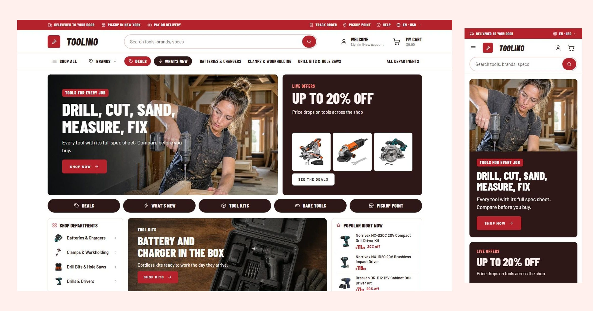
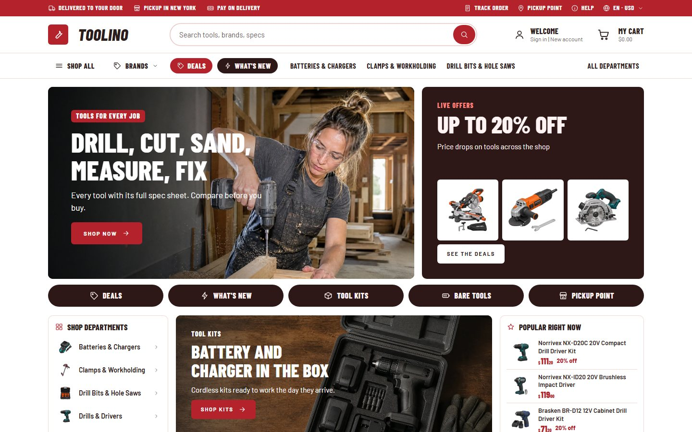
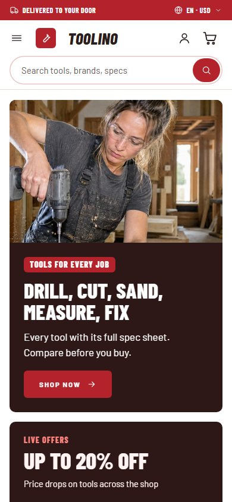
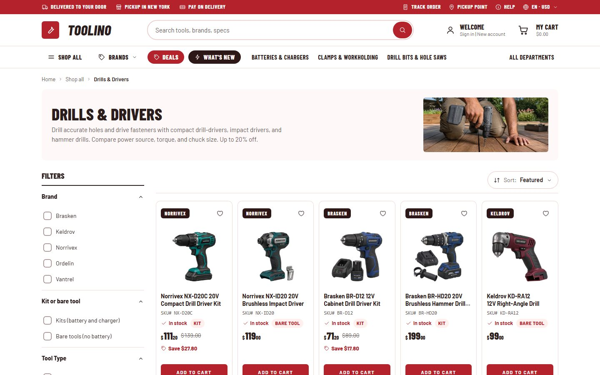
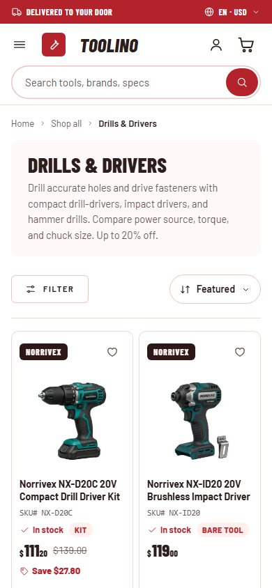
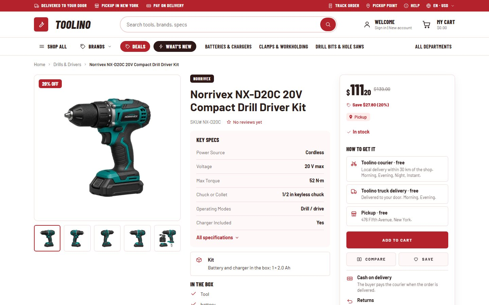
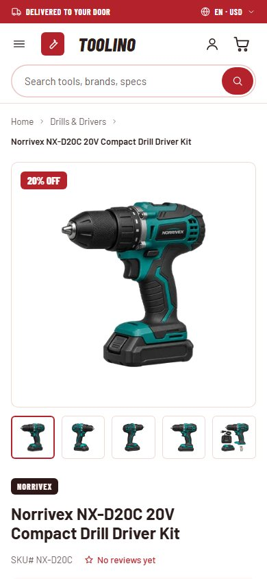
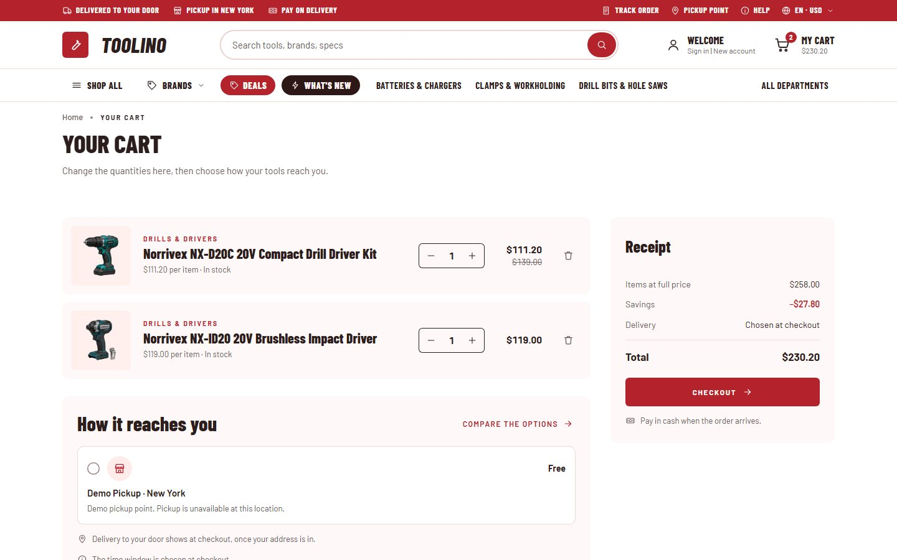
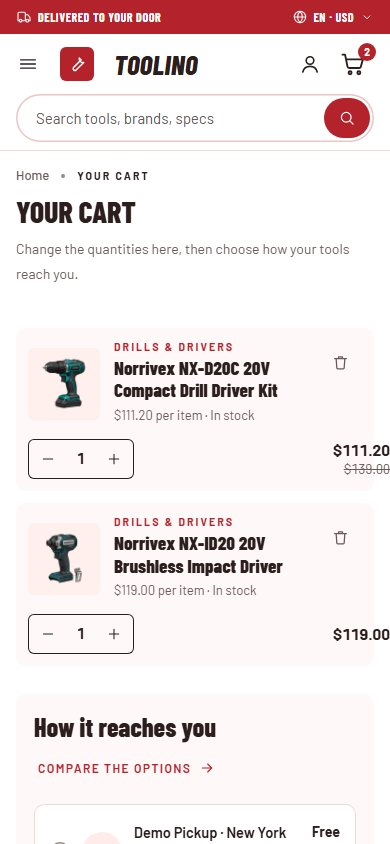

# Depot Tool Superstore

**Depot Tool Superstore** is a custom storefront **Layout** for Selldone shops: a single-seller tool shop dressed as a big hardware and power-tool superstore. A red service strip with delivery, pickup, payment, order tracking and help from the shop's own settings; a white header with the wordmark, a wide search for tools, brands, SKUs and specs, the account and the cart with its total; a navigation row with a Shop all mega menu (departments, quick links from each department's own specification, its best sellers), a Brands menu, Deals and What's new pills and the department links. The home: a photo hero beside the live offers, quick links, a promo board, today's deals as tiles, a service band, department photo tiles, a brand wall, an Explore products band, why shop here, the shop's story and its journal. Cards with a brand plate, the SKU, the stock, Kit or Bare tool from the product's own specification and the price with its cents raised; a filter sidebar built from the tools' real specification; a product page with key specs, what is in the box, a sticky buy box and the batteries that fit a bare tool; compare, the cart and the whole checkout; brands, pickup point and delivery pages. One colour family from the chosen palette (Signal red by default), light or dark, Barlow Condensed over Barlow, English and Arabic.

It runs on **[depot.selldone.shop](https://depot.selldone.shop)**, one domain of the Selldone shop Toolino. The shop's default address and its other domains carry other Layouts; Depot is pinned on its own domain only (see [Go Live](Go-Live)). It is built on the official [selldone/storefront](https://github.com/selldone/storefront), so Selldone's basket, checkout, payments and orders keep working underneath a new design.

## Start here

| I want to… | Page |
| --- | --- |
| Have an AI agent set it up on my shop | **[Install with AI](Install-with-AI)** |
| Set it up myself | [Manual Setup](Manual-Setup) |
| Know what my shop's data needs | [Shop Requirements](Shop-Requirements) |
| Build, upload and verify a release | [Build and Upload](Build-and-Upload) |
| Put it live on my shop or one domain | [Go Live](Go-Live) |
| Change the name, sections, pages, photos, languages | [Customize](Customize) |
| Change the colours, dark or light, the visitor switcher | [Theme and colours](Theme-and-colours) |
| Fix a problem | [Troubleshooting](Troubleshooting) |

## How a Selldone Layout works (one minute)

1. A **Layout** is a complete storefront app (Vue 3) that runs on Selldone's own servers instead of the default storefront.
2. You build it, zip it, and **upload** it to your Selldone developer account with the official [selldone-cli](https://github.com/selldone/cli). Each upload is a new **version**.
3. You **attach** a version to your shop, or to one domain of it.
4. Selldone injects **your** shop into the Layout: its title, collections, products, prices, delivery ways, payment methods, articles, languages, currencies and settings. Nothing about Toolino is hard-coded: not the name (the wordmark is your shop's title), not a price, a delivery window or an opening hour. The only shop-specific files are the photos in `skins/depot/photos/`; without them every photo slot shows a designed fallback made of drawings and your own products. Another shop that imports the Layout gets its own data.

## The look

| Part | Depot |
| --- | --- |
| Grounds | a white page with soft tint bands (`#fff8f8`), near-black ink `#2b1e1d`, muted words `#695958`, lines `#f0dad8`; deep panels and bands in the family's dark (`#2e1817`) |
| Action colour | Signal red `#b4232c` (white words on it) on the service strip, buttons, deal tiles, the Deals pill and the chosen state |
| Products | the shop's photos on a white plate (a light neutral in dark mode), never drawn much wider than their own pixels |
| Type and icons | Barlow Condensed in capitals for headings, the wordmark, pills and prices; Barlow for reading; inline line icons (the cart, wrench, battery, bolt, grid, layers, returns and order icons added by Depot); no faint line drawings |
| Shapes | one shape language: a circle for round things, 10 px for panels and photos, 6 px for inner parts and pills |
| Buttons | flat; hover changes the colour only; no line under any word (the one exception is a link inside a post's own text); focus rings inside the box |
| Photos | the hero (wide and square), the kit and delivery promos, About, and one photo per department (`col-<slug>.webp`); a department without one shows its own image cut out on white |
| Theme | light by default, dark in the same family; four palettes (Signal red, Charcoal, Cobalt, Pine) and a custom colour, in the footer's Theme row |
| Languages | English and Arabic (right to left); the language and currency pill in the service strip |

## What you get

- **Header:** the red service strip (door delivery, the pickup point and pay on delivery, each only when the shop offers it; Track order, Pickup point, Help, language and currency); the white header (the wrench mark and wordmark, the wide search with suggestions by name, SKU, brand and spec, the account, the cart with its count and total); the navigation row: Shop all (a mega menu: every department with its image; beside the one pointed at, quick links from its own specification and its best sellers), Brands (the products' brands), Deals, What's new, the departments that fit, All departments. On a phone: the menu button, the wordmark, the account, the cart and the search under them; the menu is a side panel.
- **Footer:** the service band (every delivery way and cash on delivery from the shop's settings), Shop, Departments, Help and Company, the Theme row, the legal row.
- **Home,** in this order (a section without its data hides itself): the photo hero beside the live offers (else the newest tools) and the quick links; the promo board (departments, a kit promo when the spec has kits, two brand banners, the popular tools); today's deals as tiles (only with live offers); the service band; department photo tiles; the brand wall; Explore products (tabs, horizontal cards); why shop here; the shop's About page beside the about photo; the journal.
- **Cards:** the brand plate and a save heart, the photo, the name, the SKU, the stock, Kit or Bare tool (only from the product's own "Battery Included" / "Power Package" rows), the price with its cents raised, the was-price and the saving, Add to cart (then − n + in place) and a Compare tick.
- **Department, search, deals, brand and every tool:** the breadcrumb and head (a department's name, line and photo), department chips, the deals band, a filter sidebar from 1200 px (a side sheet below): departments, brand, kit or bare tool, the department's own spec keys, price bands and boxes, on offer; the sort; five cards a row. `?brand=`, `?kit=kit|bare` and `?f=Key:Value` open a filtered listing.
- **Product page:** the gallery; the brand, name, SKU, key specs, the kit note and what is in the box; a sticky buy box (price, saving, stock, how to get it from the shop's ways, Add to cart, Compare, Save, cash on delivery, returns); a section bar for Overview, Specifications, Batteries that fit (a bare tool's own platform and voltage) and Reviews (an honest "No reviews yet" with the shop's rating criteria); similar tools.
- **Compare and quick view:** the picks side by side, "Only differences" and "Copy link"; a quick view from each card.
- **Cart and checkout:** a cart drawer (the lines with "− n +", the receipt, Checkout and View cart, "Often added"); the cart page; the checkout (contact, the delivery ways that reach the address or the pickup point, the address sheet with its map) up to Selldone's payment window.
- **Orders and account:** the order page with its progress and messages, the buyer's orders, addresses and saved tools.
- **Content pages:** Tool talk (the journal; a post shows its cover once, with its caption), About, Contact, FAQ, Terms, Privacy; Brands, the pickup point (its map, when to collect, the shop's note) and Delivery and returns, all from the shop's own settings, each with an honest empty state.

Depot is a skin of the Layout base (`layout-base`: Pralino 1.0.7 made neutral, itself from Domino and Bakini Noir) and keeps that buy flow underneath (Selldone's and the Kalio base's scripts for the bag, checkout, order, account, sign-in and compare); its colours, type, shapes, wordmark, home sections and photos are its skin's (`skins/depot/skin.json`).

## Screens

| Desktop | Phone |
| --- | --- |
|  |  |
|  |  |
|  |  |
|  |  |

The photos were generated with Magnific (Freepik) for Toolino under the owner's plan.

## Tested

Every release is checked before it goes up (the production bundle through the live shop's own HTML) and on the live shop after it is pinned (the full suite, each check at `TOTAL 0`). The table for each version is in the repository's [`README.md`](https://github.com/selldone-custom-layouts/official-depot/blob/main/README.md#tests).

## Links

- Live shop: <https://depot.selldone.shop>
- Repository: <https://github.com/selldone-custom-layouts/official-depot>
- What Depot is, how the mockup became the Layout, the colour family, the shape language, photos, data rules, checks and releases: [`LAYOUT.md`](https://github.com/selldone-custom-layouts/official-depot/blob/main/LAYOUT.md); the base it is skinned from: [`BASE.md`](https://github.com/selldone-custom-layouts/official-depot/blob/main/BASE.md)
- All official custom Layouts: <https://github.com/selldone-custom-layouts>
- Selldone: <https://selldone.com>
